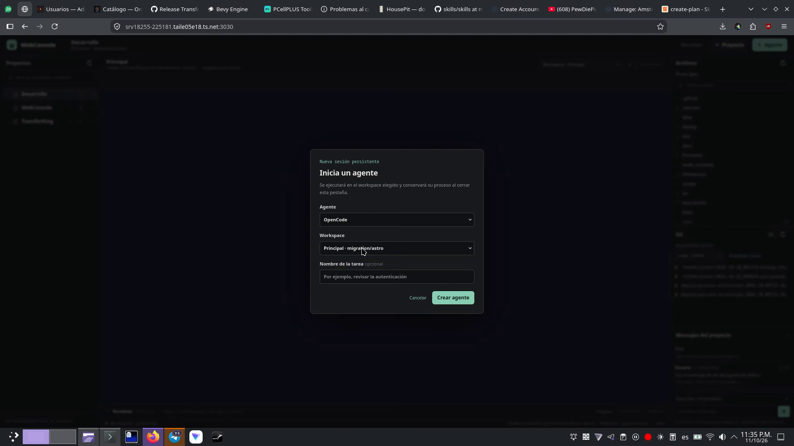
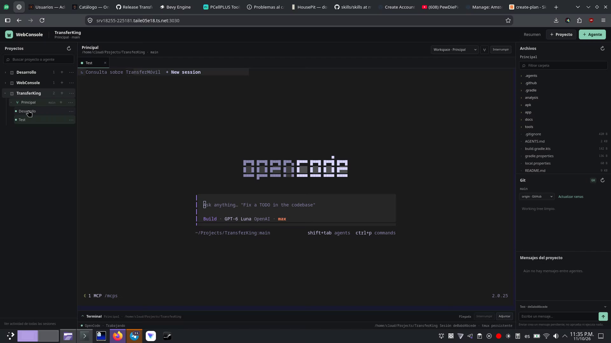
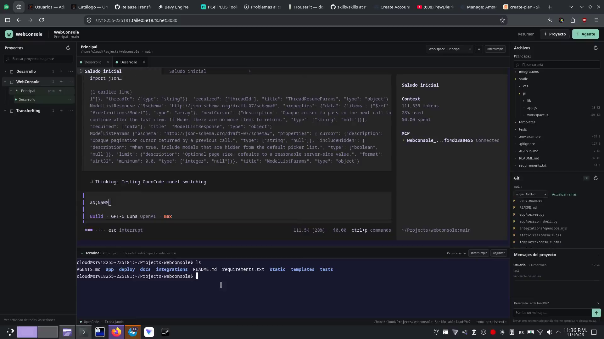
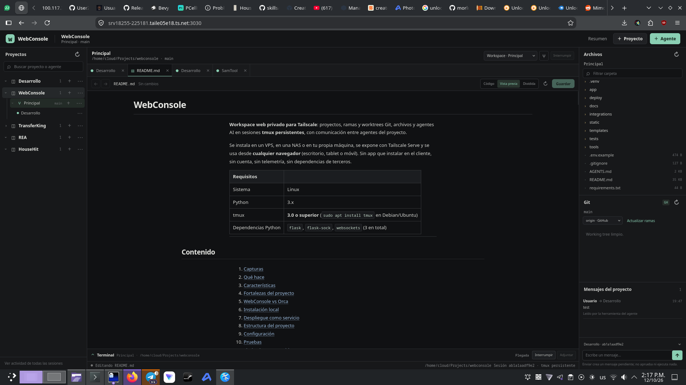
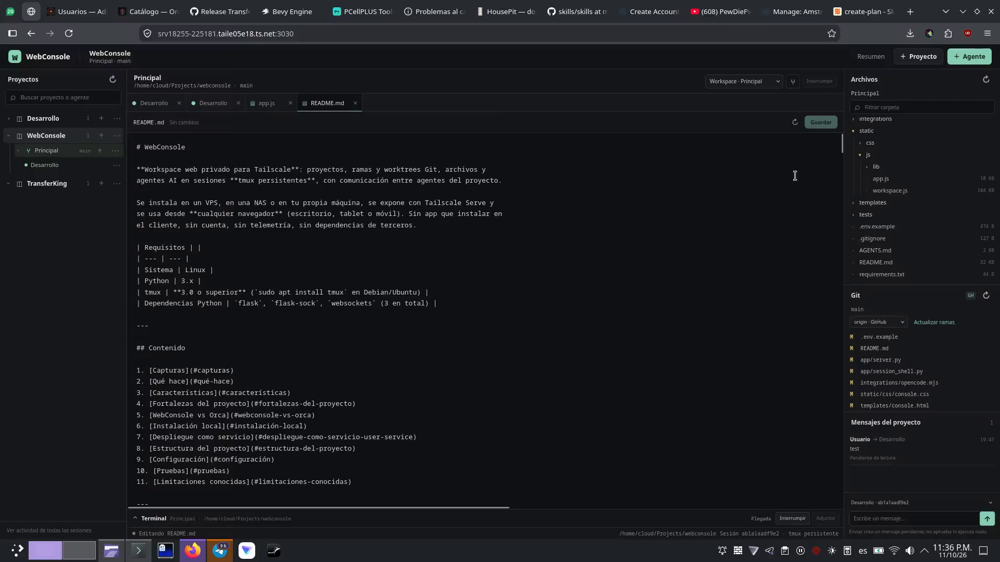

# WebConsole

**Workspace web privado para Tailscale**: proyectos, ramas y worktrees Git, archivos y
agentes AI en sesiones **tmux persistentes**, con comunicación entre agentes del proyecto.

Se instala en un VPS, en una NAS o en tu propia máquina, se expone con Tailscale Serve y
se usa desde **cualquier navegador** (escritorio, tablet o móvil). Sin app que instalar en
el cliente, sin cuenta, sin telemetría, sin dependencias de terceros.

| Requisitos | |
| --- | --- |
| Sistema | Linux |
| Python | 3.x |
| tmux | **3.0 o superior** (`sudo apt install tmux` en Debian/Ubuntu) |
| Dependencias Python | `flask`, `flask-sock`, `websockets` (3 en total) |

---

## Contenido

1. [Capturas](#capturas)
2. [Qué hace](#qué-hace)
3. [Características](#características)
4. [Fortalezas del proyecto](#fortalezas-del-proyecto)
5. [WebConsole vs Orca](#webconsole-vs-orca)
6. [Instalación local](#instalación-local)
7. [Despliegue como servicio](#despliegue-como-servicio-user-service)
8. [Estructura del proyecto](#estructura-del-proyecto)
9. [Configuración](#configuración)
10. [Pruebas](#pruebas)
11. [Limitaciones conocidas](#limitaciones-conocidas)

---

## Capturas

### Lanzador de agentes



El lanzador permite escoger el agente, workspace y nombre de tarea antes de iniciar la sesión.

### Proyectos y agente en ejecución



El árbol de proyectos y workspaces convive con la sesión persistente del agente.

### Agente y shell independiente



La shell del workspace permanece separada de la terminal del agente.

### Editor Markdown



El editor permite trabajar con archivos del proyecto junto al explorador y los paneles del workspace.

### Editor de código



Los archivos de código se editan en el mismo espacio de trabajo que los proyectos y agentes.

---

## Qué hace

WebConsole resuelve tres problemas concretos de trabajar con agentes AI en un servidor:

1. **Las sesiones se mueren.** Cerrar la pestaña, perder el WiFi o suspender el portátil
   no debería matar un agente que lleva 40 minutos trabajando. Aquí el proceso vive en
   **tmux**, no en el navegador: recargas, te desconectas o reinicias el servidor HTTP y
   al reabrir la misma URL tienes **el mismo proceso, con el mismo PID y la misma
   pantalla**.
2. **No ves qué están haciendo.** El **espacio de agentes** te muestra, cada pestaña
   abierta, qué agentes corren, en qué tarea, qué han dicho recientemente, qué necesita
   tu atención (permisos pendientes) y la pantalla actual — sin leer sus bases de datos ni
   inyectar nada en su terminal.
3. **El acceso es incómodo.** Nada de SSH desde el móvil, VS Code Remote o port-forwarding
   manual: una URL en tu tailnet y ya está. Válida desde cualquier dispositivo y cualquier
   navegador.

**Stack:** Python 3 + Flask → WebSocket → tmux (socket y configuración propios) →
xterm.js 5.31 en el navegador. Unidades de servicio systemd con `KillMode=process` para
que reiniciar el servidor web **no** toque los agentes.

La ruta `/` abre el workspace de proyectos: navegación por proyecto/workspace/agente,
terminal persistente en el panel central, explorador/editor de texto y estado Git. `/sessions`
conserva el resumen de actividad anterior.

### Proyectos, ramas y edición

- Registra una carpeta existente; WebConsole no clona ni modifica el proyecto al registrarlo.
- Consulta ramas locales y referencias remotas conocidas. **Actualizar ramas** ejecuta un
  `git fetch` explícito contra el remoto seleccionado; abrir el workspace no hace llamadas de red.
- Cada agente se inicia en el workspace elegido. También puedes crear un worktree aislado
  desde una rama local o remota sin cambiar la rama del checkout original. Los worktrees se
  guardan fuera del repositorio en `~/.local/share/webconsole/worktrees` por defecto.
- El explorador permite abrir archivos de texto UTF-8 de hasta 2 MiB. El guardado comprueba
  una revisión del contenido y avisa si otro proceso cambió el archivo. No sigue symlinks ni
  expone `.git`, metadata de sesiones o el directorio configurado para worktrees.
- Las sesiones nuevas de **OpenCode y Codex** iniciadas desde un proyecto reciben un servidor
  MCP local de WebConsole, sin editar configuración global. Ofrece listar agentes del proyecto,
  leer mensajes destinados a la sesión y enviar mensajes directos. «Leído» solo significa que
  la herramienta entregó el mensaje al agente; no confirma que lo entendiera o ejecutara.
- El clic derecho, `Shift+F10` y el botón `⋯` abren opciones para proyectos, workspaces y
  sesiones. Los menús exponen acciones aplicables como abrir/seleccionar, crear agente o worktree,
  renombrar proyecto, interrumpir y las acciones documentadas de OpenCode V2 y Codex CLI. Las
  acciones de Codex requieren confirmación porque envían un comando a la terminal.
- «Quitar proyecto» lo desregistra de WebConsole y conserva su carpeta. Antes hay que eliminar
  explícitamente sus sesiones y retirar sus worktrees administrados. Eliminar una sesión activa
  sí termina su tmux y requiere confirmación.
- Solo se pueden retirar desde la UI los worktrees limpios creados por WebConsole, sin sesiones
  asociadas, locks, cambios, archivos sin seguimiento ni archivos ignorados. La rama se conserva.
  El workspace principal no se puede retirar por separado; los worktrees preexistentes se
  detectan automáticamente y no ofrecen una acción para desvincularlos.
- Desde el menú contextual de una sesión OpenCode puedes preparar un traspaso explícito a Codex,
  revisar el extracto y sus advertencias, y conservar abierta la sesión original.

---

## Características

### Sesiones que no mueren

El shell y las herramientas corren dentro de tmux, independientemente de las conexiones
del navegador. Refrescar, cerrar una pestaña, cambiar de pestaña, perder conectividad o
suspender el navegador **solo** desconecta su cliente de terminal. Reabrir la misma URL de
sesión vuelve a engancharse al mismo proceso y redibuja la pantalla actual, incluidas
herramientas a pantalla completa como Codex. Varias pestañas reciben la misma salida.
**No hay expiración por inactividad.**

Las URLs y los metadatos de sesión se guardan en `app/sessions/` con permisos privados
(directorio `0700`, JSON `0600`, escritura atómica). Un shell terminado **sigue
terminado**: la aplicación nunca lo reemplaza en silencio por uno nuevo. Borra las
sesiones desde el dashboard cuando termines. Los límites por defecto son **32 sesiones**
y **4 conexiones de navegador simultáneas** por sesión.

La pantalla de tmux y su scrollback acotado se quedan en el servidor. Un navegador nuevo
recibe la pantalla actual; el scrollback antiguo se consulta con el modo copia de tmux
desde un attach local, no se descarga entero en cada reconexión.

La vista embebida muestra una carga oscura hasta que xterm confirma el primer render. En
reconexiones conserva la pantalla anterior y presenta el estado sin vaciar el terminal.
Los recursos JS/CSS públicos se sirven comprimidos con gzip cuando el cliente lo acepta y usan
versiones derivadas de su contenido para permitir caché larga sin conservar una UI antigua. La terminal
mantiene el protocolo ANSI comprimido por bloques: WebConsole no elimina redibujados ni puede
garantizar un volumen fijo, porque depende de lo que emita cada CLI.
Las consultas JSON repetitivas se revalidan con `ETag` desde memoria de la pestaña; las respuestas
siguen marcadas `no-store` y no se guardan en la caché del navegador.

#### Uso táctil en móviles

- En el buffer normal, un dedo desplaza el scrollback local de xterm (hasta 3000 líneas). Si estás
  leyendo más arriba, **Volver al final** solo mueve ese buffer; la salida nueva no fuerza el salto.
- Una TUI puede usar la pantalla alternativa, cuyo contenido no es scrollback local. Si xterm detecta
  seguimiento de ratón con rueda (`vt200`, `drag` o `any`), el gesto vertical se convierte en eventos
  de rueda del protocolo de ratón. La TUI decide si eso desplaza su conversación. En `x10`, sin
  seguimiento o en modos desconocidos, WebConsole muestra el límite y no envía flechas, PageUp,
  texto, Enter ni aprobaciones. La rueda no recupera salida que tmux ya haya descartado.
- No se ha validado la navegación interna de OpenCode/Codex en una sesión interactiva real; por ello,
  WebConsole no promete historial anterior dentro de esos TUI. Usa sus controles nativos cuando la
  rueda no navegue.
- La altura visible se actualiza con `VisualViewport` para teclado y orientación, sin reaccionar al
  pinch zoom. El zoom del navegador sigue habilitado; los iframes ajustan la terminal solo cuando su
  contenedor es visible y tiene dimensiones válidas.
- Paneles móviles se abren como cajones, se cierran con Escape o tocando fuera y no enfocan la
  terminal al abrirse. El redimensionador de la shell también admite flechas del teclado.

Pruebas locales de gestos y viewport: `node --test tests/frontend/mobile/*.test.mjs`. El harness
Playwright usa fixtures HTTP aislados, sin `app.server.py`, tmux, agentes ni sesiones reales:

```sh
npm ci --prefix tools/mobile-tests
PLAYWRIGHT_BROWSERS_PATH=/tmp/opencode/webconsole-mobile-browsers npm --prefix tools/mobile-tests run install:browser
PLAYWRIGHT_BROWSERS_PATH=/tmp/opencode/webconsole-mobile-browsers npm --prefix tools/mobile-tests test
```

La emulación táctil no sustituye la aceptación en Chrome/Android y Safari/iOS físicos, sobre todo
para teclado virtual, selección prolongada y pinch zoom.

#### Editor de archivos

El editor usa CodeMirror 6 y sus bundles se sirven desde `static/js/lib/editor/`; no hay
CDN ni compilación frontend al arrancar WebConsole. Los archivos Markdown abren en una
vista previa segura con modos **Código**, **Vista previa** y **Dividida**. El HTML activo
no se interpreta y las imágenes Markdown no se cargan; el resto de archivos usa resaltado
por extensión con texto plano como fallback. **Atrás/Adelante** recorre archivos y puntos
de navegación sin modificar el historial de undo/redo.

Seleccionar un cambio en Git abre una comparación de solo lectura: **HEAD → índice** para
cambios preparados e **índice → disco** para cambios no preparados. El diff no incluye el
buffer del editor, no stagea ni revierte cambios. «Abrir código» vuelve a la pestaña editable
sin descartar cambios locales.

Solo para regenerar los bundles tras cambiar paquetes o fuentes del editor:

```sh
cd tools/editor-assets
npm ci
npm run build
npm test
```

La aplicación desplegada no requiere Node. El lockfile fija dependencias y
`static/js/lib/editor/THIRD-PARTY-NOTICES.md` incluye los avisos y licencias de los paquetes
que forman los bundles.

#### Terminal del workspace, copiar e insertar adjuntos

El workspace tiene una terminal Bash independiente por workspace/worktree. Se abre al
desplegar el cajón «Terminal» y no cambia el directorio ni la sesión de un agente existente.
Plegar el cajón o cerrar el navegador solo desconecta su vista. Una shell finalizada no se
reinicia sola; «Nueva terminal» crea otra explícitamente.

En una terminal, **Ctrl+C** vuelve a su comportamiento nativo y envía la interrupción a la
shell o UI del agente, aunque haya texto seleccionado. **Ctrl+Shift+C** copia la selección
sin enviar entrada; en macOS también se conserva **Cmd+C** para copiar. El botón
**Interrumpir** sigue disponible para enviar explícitamente el byte de interrupción.

El pegado normal de texto sigue funcionando. Pegar o seleccionar imágenes, audio, vídeo o
PDF en una sesión de agente los sube a almacenamiento privado de WebConsole y prepara una
referencia `Archivo adjunto: /tmp/...` en el input, **sin pulsar Enter ni enviar la petición**.
También se puede volver a insertar una referencia pendiente desde el panel. El límite es
25 MiB por archivo, 5 por subida, 100 MiB y 50 archivos por sesión. Los archivos viven en
`WEBCONSOLE_STATE_DIR/attachments` (directorios `0700`, archivos `0600`) y se purgan tras
siete días si la sesión ya terminó; la ruta `/tmp/webconsole-attachments-UID/...` es un
alias privado para que tmux y el servidor web vean los mismos bytes con `PrivateTmp`.

La garantía común es subir y pegar la ruta. **Que el agente/modelo entienda una imagen,
audio o vídeo depende de su CLI y modelo**; WebConsole no convierte ni procesa esos archivos.
Cuando el portapapeles del navegador no exponga archivos, usa «Adjuntar». La página debe
estar en HTTPS o localhost para las funciones de portapapeles del navegador.

**Supervivencia a reinicios:** la unidad systemd incluida usa `KillMode=process`, así que
reiniciar el servidor HTTP deja vivo al servidor tmux y a todas las herramientas, y la
metadata restaura las mismas URLs. Un reinicio de la máquina, un borrado explícito de
sesión, la terminación de tmux o una política de cierre de sesión del sistema sí pueden
terminar las herramientas: configura el *lingering* de servicios de usuario con tu
administrador si los servicios deben sobrevivir al logout.

> **Migración desde la versión anterior con PTY:** los shells existentes no se pueden
> trasladar a tmux. Termina o guarda el trabajo de esas sesiones antes de reiniciar el
> servidor antiguo y crea sesiones nuevas después de la actualización. Las URLs de la
> versión anterior solo vivían en memoria y no se pueden restaurar.

### Espacio de agentes

La portada muestra el ID de sesión, el proceso del agente o la herramienta, el nombre de
la tarea, el directorio de trabajo, los mensajes y la actividad de herramientas recientes,
los avisos pendientes y la pantalla actual del terminal. Incluye **búsqueda**, **filtros
de estado** (todas / trabajando / pendientes / en espera) y **ordenación** con los
pendientes primero. Las actualizaciones conservan el foco del teclado, los previews
expandidos y el feed que estás leyendo. Las pestañas ocultas pausan el sondeo del
dashboard; el servidor sigue monitorizando.

El monitor muestrea tmux y los descendientes del proceso del pane **cada 2 segundos**.
Reconoce **Codex, OpenCode, Hermes, Claude Code y Aider**, incluidos los wrappers de
intérprete habituales; cualquier otro proceso aparece como herramienta. No lee bases de
datos de agentes ni inyecta entrada en el terminal. Las previsualizaciones de pantalla
están acotadas y cada sesión conserva como máximo **60 entradas de actividad** (16 por
respuesta). Mensajes muy rápidos que aparecen y desaparecen entre muestreos pueden no
capturarse.

**Precisión del estado:** la presencia del proceso se *observa*. Los estados
trabajando/en espera derivados del CPU o de cambios de pantalla se marcan como
**«Actividad estimada»**. Un proceso silencioso puede estar esperando a una API, a una
entrada del usuario o a una herramienta larga: **el silencio nunca se interpreta como
tarea completada**. Los avisos de permiso en la pantalla visible son estimaciones y no
incluyen scrollback antiguo. Los eventos nativos del agente aportan estado confirmado y
avisos de finalización. La desaparición de un proceso de herramienta genera un aviso de
*proceso terminado*, distinto de un turno de agente completado. **Ver o marcar un aviso de
permiso nunca aprueba el comando.**

Los avisos pendientes y sus acuses se guardan en los metadatos privados de la sesión. Los
acuses incluyen una huella (*fingerprint*), de modo que una pestaña obsoleta no puede borrar
un aviso nuevo. La lista de actividad vive en memoria: tras un reinicio del servidor parte
de la pantalla actual, mientras los avisos guardados persisten.

### Lanzador de agentes e integraciones nativas

Usa **Nueva sesión** para elegir un agente, dar nombre a la tarea y fijar su directorio de
trabajo. **Consola · detección automática** abre Bash y observa lo que sea que ejecutes.
Cuando un agente lanzado por el selector termina, la sesión vuelve a Bash en lugar de
reiniciar ese agente. El lanzador carga el entorno de tu shell de *login* (incluidas las
rutas de NVM) y reaplica el directorio de trabajo elegido.

| Agente | Mecanismo |
| --- | --- |
| **Codex** | El *completion hook* se inyecta como override de CLI (`-c notify=…`) **sin modificar** `~/.codex/config.toml`. Cubre el fin de turno; los permisos y la actividad se observan desde la terminal. |
| **OpenCode** | Plugin local (`integrations/opencode.mjs`) añadido mediante `OPENCODE_CONFIG_CONTENT`, fusionado con tu configuración existente. Emite permisos, cambios de estado, mensajes y ciclo de vida de herramientas; los mensajes en *stream* se coalescen y actualizan en el sitio. |
| **Hermes** | CLI arrancado con observación de pantalla y proceso. Para eventos de herramienta y turno confirmados, añade estos hooks a tu perfil de Hermes con las rutas absolutas de tu instalación. El consentimiento inicial de hooks de Hermes sigue siendo suyo: WebConsole no lo acepta por ti. |
| **Claude Code, Aider** | Detección por nombre de proceso (sin integración de eventos). |
| **Cualquier herramienta** | Cualquier ejecutable puede informar eventos sin peticiones de red, heredando `WEBCONSOLE_EVENT_DIR`. |

Ningún lanzador habilita aprobaciones automáticas.

#### Traspaso OpenCode → Codex

El menú «Cambiar de agente…» requiere una conversación OpenCode enlazada por su plugin con el
ID nativo de sesión; no adivina desde el scrollback de tmux. WebConsole comprueba que el origen
no esté trabajando ni esperando un permiso, exporta el historial con `opencode session export
--sanitize`, excluye razonamiento interno e instrucciones de sistema del origen y presenta una
vista previa antes de crear Codex. Si el historial cambia entre la vista previa y la confirmación,
se cancela esa captura. Los mensajes completos se conservan sin truncar en un paquete privado
`WEBCONSOLE_STATE_DIR/handoffs` (`0700`/`0600`) y Codex los consulta por páginas mediante un MCP
local configurado solo para ese proceso; un documento de continuidad identifica la última
interacción y obliga a revisar la transcripción para distinguir petición, trabajo hecho, pendientes
y verificaciones.

La opción predeterminada **Revisar y esperar** pide a Codex presentar un resumen y esperar; la
continuación activa es explícita y sigue sujeta a los permisos normales de Codex. Ningún resultado
ni permiso histórico se considera una aprobación actual. Los bytes de adjuntos no se exportan;
solo sus referencias saneadas. En esta primera versión solo está habilitado **OpenCode → Codex**;
Hermes y los traspasos desde otros agentes no se anuncian como compatibles. El paquete se elimina
al borrar la sesión destino.

```yaml
# integraciones de Hermes — ajusta las rutas a tu instalación
hooks:
  pre_llm_call:
    - command: "/ruta/a/webconsole/.venv/bin/python /ruta/a/webconsole/integrations/hermes_event.py pre_llm_call"
  pre_tool_call:
    - command: "/ruta/a/webconsole/.venv/bin/python /ruta/a/webconsole/integrations/hermes_event.py pre_tool_call"
  post_tool_call:
    - command: "/ruta/a/webconsole/.venv/bin/python /ruta/a/webconsole/integrations/hermes_event.py post_tool_call"
  on_session_end:
    - command: "/ruta/a/webconsole/.venv/bin/python /ruta/a/webconsole/integrations/hermes_event.py on_session_end"
```

Cualquier otra herramienta puede notificar por su cuenta, sin red ni credenciales:

```bash
.venv/bin/python app/agent_event.py --type completed --agent hermes --message 'La tarea terminó'
```

Los ficheros de evento son privados, están limitados a **128 eventos pendientes** por
sesión y los consume el monitor. Los hooks **no** emiten directivas de permiso y **nunca**
bloquean esperando respuestas de red.

> En las sesiones creadas desde el selector, `WEBCONSOLE_EVENT_DIR` se hereda
> automáticamente. Para agentes lanzados a mano, abre una sesión nueva después de la
> actualización para que reciban la variable.

### Terminal

- **xterm.js 5.31** con *addons* **Fit** (ajuste automático) y **WebLinks** (URLs
  clicables), scrollback de 3000 líneas y tema oscuro.
- **Compresión zlib**: los frames del servidor se envían comprimidos cuando superan los
  192 bytes y el cliente los descomprime con pako.
- **Modo de entrada Local / Live (`Ctrl+B`)**: en *Local* la línea se edita y se dibuja
  localmente (Backspace, `Ctrl+A/E/U/W`, flechas, Delete) y solo se envía al terminal al
  pulsar Enter — escrito sobre enlaces débiles o desde el móvil. En *Live* cada tecla va
  directamente al TUI. La preferencia se guarda en `localStorage`.
- **Sugerencias al estilo Warp**: historial de comandos de la pestaña (máx. 120,
  `sessionStorage`) y **autocompletado de rutas** (`cd`, `ls`, `cat`, `vim`, `nano`,
  `code`, `open`…) con debounce y control de carreras. Navegación con ↑↓ y Tab.
- **Conexión robusta**: *heartbeat* `ping/pong` cada 25 s con latencia en la barra de
  estado, detección de socket estancado a 75 s, reconexión exponencial con *jitter* (máx.
  30 s) y reanudación al volver la pestaña a primer plano u `online`.
- **Multi-pestaña** hasta 4 clientes por sesión con salida idéntica, fullscreen, copiar
  enlace, Ctrl+L y confirmación antes de matar una sesión.
- El historial de comandos solo vive en el `sessionStorage` de la pestaña.

### Seguridad

Este es un servicio de terminal **single-user**. Cualquiera con acceso al dashboard puede
crear shells, ver los enlaces de sesión y borrar sesiones, con los permisos de SO de la
cuenta de servicio: usa una cuenta desprivilegiada y dedicada. **Tailscale solo no es
aislamiento individual de sesiones.**

- El bind por defecto es `127.0.0.1`; el acceso se restringe con Tailscale Serve (HTTPS) y
  las ACL de Tailscale.
- El *attach* por WebSocket exige un **token de sesión válido** (comparación en tiempo
  constante) y un **Origin** coincidente.
- Las mutaciones de la API exigen una **cabecera personalizada** (`X-WebConsole: 1`) y
  rechazan orígenes ajenos: protección CSRF sin tokens que guardar.
- Cabeceras de respuesta: `Referrer-Policy: no-referrer`, `X-Content-Type-Options:
  nosniff`, `X-Frame-Options: DENY`, CSP `frame-ancestors 'none'`, `Cache-Control:
  no-store` fuera de `/static/`.
- Tamaños acotados: peticiones y frames de 64 KiB, líneas de completado de 8192, títulos
  de 100, columnas 20–500, filas 5–200, IDs de sesión por *regex* y **whitelist** de
  agentes lanzadores.
- Todo el contenido generado por los agentes se inserta con `textContent` (sin XSS) y los
  ficheros de sesión/eventos son `0600` en un directorio `0700`.
- El shell hijo **no** recibe `WEBCONSOLE_PASSWORD` ni `SECRET_KEY`.
- La unidad systemd incluida endurece el servicio: `UMask=0077`, `NoNewPrivileges`,
  `PrivateTmp`, `ProtectSystem=full`, `RestrictSUIDSGID`, `TasksMax=512`.

**Autenticación opcional:** con `WEBCONSOLE_PASSWORD` en el entorno del servicio se exige
HTTP Basic (cualquier usuario, la contraseña configurada) y la sesión pasa a una cookie
firmada `HttpOnly` + `SameSite=Strict`. Usa **HTTPS**; HTTP Basic sobre HTTP claro no está
cifrado. Fija un `SECRET_KEY` estable y aleatorio y `COOKIE_SECURE=1` con HTTPS, y rota
también `SECRET_KEY` al revocar cookies existentes. Mantén `.env` privado (`chmod 600`).

Los enlaces de sesión son **credenciales tipo bearer**: no los compartas ni registres las
URL completas. Si usas un proxy inverso que no conserva `Host`, define
`PUBLIC_ORIGIN=https://tu-dispositivo.tu-tailnet.ts.net`. No expongas esta terminal en
público sin una revisión previa de autenticación y control de acceso.

---

## Fortalezas del proyecto

- **Semántica de sesión de nivel SO.** El proceso pertenece al servidor, no al navegador.
  Está implementado *y testeado*: reinicio completo del servidor HTTP → mismo PID de shell,
  mismas URLs, misma pantalla.
- **Honestidad sobre sus propios límites.** El estado se separa en `event` (confirmado) /
  `estimated` (CPU o pantalla) / `process` (presencia), y el documento dice explícitamente
  que el silencio no es completado y que un aviso en pantalla no es un permiso aprobado.
  Pocos proyectos describen con tanto detalle lo que **no** saben.
- **Observación sin invasión.** Lee `/proc` y la pantalla de tmux; no lee bases de datos de
  agentes ni inyecta teclado. Y los hooks **nunca** bloquean: la observabilidad no puede
  impedir que un agente termine su *hook*.
- **Superficie mínima y auditable.** ~2.800 líneas propias, 3 dependencias, sin build step
  ni framework JS. Se lee completo en una tarde — incluida toda la lógica de seguridad.
- **Modelo de amenaza explícito.** Una cabecera + Origin controlan toda la mutación; tokens
  bearer con comparación constante; entorno hijo saneado; ficheros con permisos privados.
- **UX que respeta tu atención.** Actualización *in-place* sin reconstruir el DOM (foco,
  `<details>` y scroll del feed preservados), polling pausado en pestañas ocultas, acuses
  con huella anti-pestaña-obsoleta y apertura de pestañas sin bloqueador de pop-ups.

---

## WebConsole vs Orca

[Orca](https://www.onorca.dev/) y WebConsole **sí compiten**: ambos ofrecen un espacio para
trabajar con agentes de código, cambiar entre proyectos, inspeccionar cambios y coordinar
trabajo paralelo. La diferencia ya no es «orquestador frente a terminal»: está en el modelo
de ejecución, el grado de automatización y dónde vive el estado.

| Área | **WebConsole** | **Orca** |
| --- | --- | --- |
| Producto | Workspace web autoalojado para proyectos, terminales y agentes | Entorno de desarrollo/orquestación de agentes de escritorio |
| Ejecución y persistencia | Procesos CLI en tmux del servidor; las vistas web se pueden cerrar y reconectar | Sesiones y tareas administradas por Orca dentro de su entorno |
| Proyectos y trabajo paralelo | Proyectos, workspaces, agentes y worktrees Git | Proyectos, agentes y worktrees dentro del flujo de orquestación |
| Editor y cambios | Editor CodeMirror, vista Markdown y diffs Git de solo lectura | Editor y herramientas integradas para revisar cambios |
| Coordinación | Mensajes entre agentes del proyecto y traspaso explícito OpenCode → Codex | Flujos de tareas y despacho de trabajo entre agentes |
| Automatización | Control explícito por sesión; no crea un DAG de tareas automáticamente | Más énfasis en planes, tareas y coordinación supervisada |
| Acceso | Navegador desde la red configurada por el usuario (por ejemplo, Tailscale) | Aplicación y superficies de acceso que mantiene Orca |
| Operación y datos | Servicio propio; sesiones y archivos bajo el directorio privado configurado | Depende de la distribución, integraciones y políticas vigentes de Orca |

Las funciones y planes de Orca cambian con frecuencia; consulta su documentación para la
matriz actual. Esta comparación describe el diseño de WebConsole y evita afirmar que una
capacidad de Orca falta en WebConsole cuando ambas ya ofrecen una alternativa.

**WebConsole encaja mejor** si priorizas autoalojamiento, sesiones tmux que sobreviven a
desconexiones y reinicios del servidor web, acceso desde un navegador y control directo sobre
los procesos y archivos en tu máquina.

**Orca puede encajar mejor** si buscas que la propia aplicación gestione planes, despacho y
coordinación más automatizada de equipos de agentes, y prefieres su entorno integrado.

No son necesariamente excluyentes, pero ahora **se solapan en el mismo espacio de producto**;
elige según el modelo operativo que quieras, no bajo la premisa de que uno solo ofrece un
workspace, editor o soporte para worktrees.

---

## Instalación local

```bash
git clone https://github.com/UserZero075/webconsole.git
cd webconsole

python3 -m venv .venv
. .venv/bin/activate
pip install -r requirements.txt
python app/server.py
```

Abre `http://127.0.0.1:3030/` y registra un proyecto. La dirección de bind por defecto es *loopback*; usa
Tailscale Serve para HTTPS y restringe el acceso con las ACL de Tailscale.

Para ejecutarlo directamente, exporta las variables de entorno antes de arrancar Python:
el fichero `.env` lo carga la unidad de systemd suministrada, **no** Python.

---

## Despliegue como servicio (user service)

Instala [deploy/webconsole.service](deploy/webconsole.service) como
`~/.config/systemd/user/webconsole.service` y ejecuta:

```bash
systemctl --user daemon-reload
systemctl --user enable --now webconsole.service
```

La unidad incluida usa `KillMode=process`: reiniciar el servidor HTTP deja corriendo al
servidor tmux y a las herramientas, y su socket vive en el directorio de estado persistente
(fuera del directorio temporal privado de systemd). **Conserva este ajuste** si adaptas la
unidad: la limpieza por *control group* que hace systemd por defecto mataría las
herramientas durante un reinicio.

---

## Estructura del proyecto

```text
webconsole/
├── app/
│   ├── server.py             # Servidor Flask: API, WebSocket, seguridad y entrypoint
│   ├── telemetry.py          # Monitor tmux/proc y eventos estructurados
│   ├── agent_event.py        # Emisor CLI/genérico de eventos
│   ├── projects.py           # Registro privado de proyectos y workspaces
│   ├── git_service.py        # Ramas, estado Git y creación controlada de worktrees
│   ├── filesystem.py         # Exploración y guardado acotado bajo una raíz
│   ├── coordination.py       # Buzón de mensajes por proyecto
│   ├── coordination_mcp.py   # Herramientas MCP locales para OpenCode/Codex
│   ├── session_shell.py      # Entorno de login, launcher y MCP por sesión
│   ├── pty_exec.py           # Cliente de terminal tmux con TIOCSCTTY
│   ├── tmux.conf             # Configuración de tmux aislada de la del usuario
│   └── sessions/             # Metadata privada por sesión (0600) — ignorada por git
├── integrations/
│   ├── opencode.mjs          # Plugin de OpenCode: permisos, estado, mensajes, herramientas (65)
│   └── hermes_event.py       # Adaptador de los hooks de Hermes (40)
├── templates/
│   ├── index.html            # Espacio de agentes (dashboard)
│   ├── workspace.html        # Workspace integrado de proyectos y archivos
│   └── console.html          # Terminal: WebSocket, xterm, modo Local/Live y sugerencias
├── static/
│   ├── js/app.js             # Resumen de actividad: sondeo, filtros y previews
│   ├── js/workspace.js       # Lógica del explorador, sesiones, Git, editor y mensajes
│   ├── js/lib/               # xterm.js y addons vendorizados + pako
│   └── css/                  # styles.css (dashboard) y console.css (terminal)
├── docs/images/              # Capturas usadas en este README
├── deploy/webconsole.service # Unidad de systemd (KillMode=process, endurecida)
├── tests/                    # pytest: persistencia, seguridad, Git, archivos y coordinación
├── requirements.txt          # flask, flask-sock, websockets
├── .env.example              # Documentación de la configuración
└── README.md
```

---

## Configuración

| Variable | Por defecto | Propósito |
| --- | --- | --- |
| `HOST` | `127.0.0.1` | Dirección de bind HTTP |
| `PORT` | `3030` | Puerto HTTP |
| `WEBCONSOLE_STATE_DIR` | `app/sessions` | Directorio privado de metadata y socket de tmux |
| `WEBCONSOLE_WORKTREE_DIR` | `~/.local/share/webconsole/worktrees` | Destino privado para worktrees creados desde WebConsole |
| `MAX_SESSIONS` | `32` | Límite de sesiones, incluidas las terminadas |
| `PUBLIC_ORIGIN` | *Host* de la petición | Origen exacto permitido en el navegador |
| `WEBCONSOLE_PASSWORD` | Sin definir | Contraseña compartida opcional |
| `SECRET_KEY` | Aleatorio en cada arranque | Secreto de firma de la cookie de autenticación |
| `COOKIE_SECURE` | `0` | `1` cuando se sirve por HTTPS |

Los límites de conexiones simultáneas por sesión (4) y los tamaños máximos están
definidos en `app/server.py` y `app/attachments.py`. El explorador limita archivos a 2 MiB
y entradas de directorio a 500; los mensajes entre agentes a 8 KiB.

---

## Pruebas

```bash
.venv/bin/pip install -r requirements.txt pytest
.venv/bin/python -m pytest tests -q
```

Los tests de integración usan sockets de tmux aislados y un servidor HTTP/WebSocket local.
Comprueban: salida desenganchada, PID del shell preservado, recuperación de pantalla,
recarga de metadata, varias pestañas, revocación de URLs, protecciones de petición
(header y Origin, token inválido, permisos de fichero, cabeceras de respuesta), autenticación
opcional, reinicio completo del proceso HTTP conservando tmux, eventos nativos con
fingerprint y acuse, autocompletado, persistencia de proyectos, límites del explorador,
conflictos de guardado, inspección Git/worktrees, terminal auxiliar, permisos/propiedad y
retención de adjuntos, registro de mensajes, autenticación MCP y preparación/confirmación
idempotente de traspasos.

---

## Limitaciones conocidas

Para que la decisión de usarlo sea informada:

- **Single-user, sin RBAC ni auditoría.** No hay registro de quién ejecutó qué; quien
  tiene acceso al dashboard ve los previews y puede borrar sesiones.
- **Servidor único y estado en memoria.** La actividad en vivo se pierde al reiniciar el
  servidor (los avisos persisten). No hay réplicas ni HA.
- **Sin protección por fuerza bruta** en la contraseña opcional (sí hay límites de tamaño
  y de número de sesiones).
- **Sin HTTPS propio**: depende de Tailscale Serve o de tu proxy.
- **Detección de agentes basada en Linux** (`/proc`) y, para Claude Code y Aider, solo por
  nombre de proceso (sin eventos nativos).
- **No es un orquestador de tareas**: no crea DAGs, asigna tareas automáticamente, fusiona
  ramas ni gestiona PRs de GitHub. Los worktrees y mensajes son acciones explícitas del usuario
  y de los agentes.
- **La compatibilidad multimedia depende de cada CLI/modelo.** WebConsole no puede garantizar
  que un agente procese la ruta de un archivo ni leer formatos por él.
- **Traspasos limitados a OpenCode → Codex.** OpenCode debe haber escrito su ID nativo mediante
  el plugin de WebConsole y estar en espera; una conversación no enlazada o con permiso pendiente
  requiere resolver ese estado primero. No se transfieren adjuntos binarios ni razonamiento privado.
- **Tests de UI como contract tests** sobre el código fuente, no incluidos como suite de
  navegador automatizada.

---

## Referencias

- [tmux session attachment](https://man.openbsd.org/tmux)
- [Flask-Sock connection options](https://flask-sock.readthedocs.io/en/latest/quickstart.html)
- [Codex notify](https://learn.chatgpt.com/docs/config-file/config-advanced#notifications)
- [OpenCode plugins](https://docs.opencode.ai/docs/plugins/)
- [OpenCode configuration merging](https://opencode.ai/docs/config/)
- [Orca — The agent development environment](https://www.onorca.dev/)
